# Structs Command Deck

A full game client for [Structs](https://structs.ai), the 5X space strategy game on the Cosmos blockchain where sentient machines fight over Alpha Matter. It runs in the browser: your recovery phrase is sealed in the tab, every move is signed there and sent straight to the chain, proofs of work grind on your CPU threads and GPU, and the guild layer (Guild API, Matrix comms, the GRASS event stream) is a click away.

## Look and feel

The client is designed like a Dreamcast game: show it, don't say it.
- **Screens**: icons and big numbers come first, labels are one to three words, and explanations wait in hover titles, the **?** card and Expert mode.
- **The front door**: PRESS START (any key, button or tap), then four doors.
- **Buttons**: face-button colours are verbs (A goes, B backs out, X guards, Y drifts). The A/B badges appear only while a pad is in use; in battle a keyboard sees its own keys instead.
- **Controllers**: any gamepad plays the whole game. Back jumps to the hubs, the d-pad walks and aims, and a hit rumbles the pad like the Jump Pack.
- **Picture**: the 3D view draws about 480 lines in dithered 16-bit colour, like the console's 640×480 (Settings › Dreamcast picture turns it off).
- **Touch**: tap any icon or number to see its name for a moment, the way hover works with a mouse.
- **The VMU**: a 48×32 screen in the top bar shows your commander's mood and charge as pixels. Without a commander it keeps a pet that hatches on your first win and grows up at five. Tap the VMU to see what it shows.
- **Results**: stars, three numbers, the XP bar filling toward your next rank, and the next fight one press away. Every fight pays a little XP (more for a win and for each star), so playing again always counts.
- **Touch battles**: tap a weapon, tap a red-ringed enemy to see the odds (a tap near a small ship counts), and press Fire on its card.
- **One button plays**: Enter (or A) always does the next useful thing. It picks a ship, aims, fires, hands over to a ship that has something in reach, or says how to close the distance.
- **A gentle ramp**: battles start Small until your third win, and the results offer the next size up after each win.

How it is made and tested (the art bible, `pnpm studio` and its gates: soak, cert, playtest, smoke) is in [docs/STUDIO.md](docs/STUDIO.md).

## Learn

The client is built so a curious thirteen-year-old can find their way in and keep going: easy to start, deep enough to stay. Nothing was taken out to make it simple. It is grouped and explained instead.

- **Six hubs** hold every screen, each a round icon in its own colour: **Base** (My Base, Rank & Missions, Moves in Progress), **Battle** (Training Battles, Daily Challenge, Battle Replays, Unit Guide), **Explore** (Galaxy Map, Power Grid, News & Rankings), **Trade** (Power, Fuel, Energy Market, Banks, Send & Balances), **Team** (Chat, Guild Hall, All Guilds) and **Lab** (Command Line, Code Lab, Robot Helpers, Robot Rules, Proof Engine, System Health). A hub opens a menu of picture tiles with one word each. What a screen is for is in its hover title. The menu marks the screen you're on, puts a lock on screens that need a commander, and links the Academy track that teaches them with your progress. <kbd>1</kbd>–<kbd>9</kbd> pick a tile, and arrows (or a pad's d-pad) walk the grid.
- **Academy** (`/academy`): three tracks of short lessons, with a quiz or a task in each.
  - **Strategy:** units, ambits, charge, guards, stealth, Command Ships, replays, the Daily and the Gauntlet.
  - **Economics:** Alpha Matter, risk, power supply and demand, scarcity, the energy market, price per unit and exchange rates.
  - **Technology:** blocks, proof-of-work hashing, the command line, real chain messages, if-then robot rules, reading the robots' program, keeping a recovery phrase secret, Expert mode and system health.
  - **How lessons finish:** a lesson completes when you do the thing (win a training battle, open the command line, look at a message in the Code Lab) or answer its quiz. Quiz choices are shuffled per lesson, with a hint after two misses. Each lesson pays XP into the service record, so learning ranks you up like playing does, and a finished track earns a badge.
  - **Practice games:** each track ends in an endless practice game with a streak.
    - **Who can hit whom?** (Strategy) asks yes/no questions built from the real unit data ("Can a Cruiser in Water hit a SAM Launcher in Land?") and checks them with the same reach rules battles use.
    - **What does it cost?** (Economics) asks kW × days × price questions. The wrong answers are the real slips: a forgotten factor, or adding instead of multiplying.
    - **Be the computer** (Technology) shows a simplified copy of the robots' program and a helper's situation, and asks which line runs.
  - **Also:** the sidebar shows today's Daily Challenge and your streak, the **Commander career** tab is the live game's mission ladder, and the **Glossary** explains every game word. Progress stays in the browser and nothing needs an account.
- **Help where you are**: press <kbd>?</kbd> (Back on a pad) on any screen for a short card: what it is, three things to try, and its lesson. Settings › Screen tips shows a card the first time you open each screen; it's off by default, so the game can speak for itself. Words with a dotted underline (charge, alpha, ore, shield, power…) explain themselves on hover or tap, and every icon's meaning is in its title.
- **A calmer top bar**: round icons for the six hubs, then the Academy (with your progress), **Find** (the command line: names, ids, addresses, screens and verbs), chat, the vault and your moves. The **VMU** shows your pinned commander's mood, charge and ore at risk as pixels, or a pet that grows with your wins. Then one connection dot, **?** and a **More** menu (Academy, chat, help, find, manual, glossary, welcome, tips, settings, expert, sound, picture, health). **Expert mode** (More menu, Settings, or `expert` in the command line) brings back the technical layer. On a phone the bar keeps the hubs, the vault and More at full touch size.
- **Front door**: the galaxy's title is the logo and **PRESS START**, then four doors (Enlist, Battle, Learn, Watch). Left idle, it tours the live galaxy's battle sites and busiest worlds until any input. More › Welcome brings the doors back anywhere. The **Field manual** is tabbed: Start here, Places (hub by hub, with how each screen works), Keys, Words, About.
- **Expert mode, off by default**: the game reads plainly until you ask for more. With it off, these step back:
  - chain links and the block height in the top bar;
  - raw event names (`tm.event=Tx`, `EventAttack`), transaction hashes and block numbers;
  - data sources ("testnet LCD at block…", `structsd v0.21`, GRASS and the indexer);
  - the validator status and fee on reactor cards;
  - market penalties, slippage dials and proof-engine tuning;
  - field keys, HD indexes, crew and signer panels;
  - finer battle stats.

  Plain stand-ins fill the gaps:
  - mining clocks read "puzzle easy in 3h" rather than "51.4d · D1";
  - battles count turns rather than block heights;
  - reactors are "working" or "stopped".

  Nothing is removed: one switch shows it all.
- **Start over** (Settings) clears the Academy for a new learner on a shared computer, and rank and XP stay. After finishing a lesson, **Next lesson** opens the next one. My Base puts *What to do next* at the top. The galaxy's first tip points at the six hubs, which glow until it's closed.
- **Larger text** (Settings) steps the small labels and fine print up a size. Tiles with room for only a word keep theirs.
- **Easier battles**: the first battle teaches its first shot in three short callouts (Weapon, Fire, Charge). The callouts dock above the controls; each waits until you've done it, with the turn clock held and the control it asks for pulsing. They name the buttons of your input: A on a pad, 1 on a keyboard, a tap on touch. A first battle starts Easy. Setup is one question, asked as ship counts (Small 5, Medium 9, Large 13, Random ?), plus Gauntlet and Daily tiles. Computer skill (★ to ★★★), autopilot and turn length fold behind a gear. The HUD is meters and icons: charge, the Command Ship's crown and health, the turn. Charge grows one a turn and any move empties it; the armed move's minimum is marked on the battery. Orders are face buttons (A fire, X guard, Y drift, with Y opening a layer picker). The results screen gives up to three stars, three numbers and one next step.
- **Clearer on every screen**: the Code Lab opens one group of moves at a time. Replays call each shot as a number ("-2", BLOCKED, DESTROYED), and a fight of several attacks shows as one row with ×N. Unit Guide stats are icon chips and pips. My Base's vitals are icon chips, and its advisor is one card with an A button. The offline message still says that Training battles and the Academy work.
- **Code you can read**: the Code Lab writes each move as a function call that updates as you type: `structAttack({ operatingStructId: "5-12", targetStructId: ?, weaponSystem: ? })`.
- **Robot rules as a program**: Robot Rules lists the standing orders as an if-then program that mirrors what the helpers do, top to bottom, first match wins (`if (job == "productive" and alpha > 2 + 0.1) return sendHome(alpha − 2)`). It rewrites itself as you change a setting. A Technology lesson, *Look under the hood*, completes the first time you switch on Expert mode.
- **Words only where they help**: tabs, panels and buttons are an icon and a word or two, and every number carries its icon. The sentence that used to explain each one lives in its hover title, the **?** card or Expert mode. The Power Grid, Galaxy, chat sign-in and Guild Hall read as pictures and numbers. Moves and puzzles show as icons with *Done ✓* or a countdown. The command line opens with ten popular places, and typing a game word ("charge", "alpha") shows what it means.
- **Enlisting in two taps**: a *Random* button suggests a game name (Nova-Falcon, Comet-Otter…), and the biggest guild is picked already.
- **Safe by default**: enlisting asks for a game name rather than a real one, and the vault says plainly never to share the recovery phrase with anyone, including someone claiming to be from Structs. The Technology track has a lesson on it. Chat checks every message before sending. A run of 12 to 24 recovery-phrase words that passes the phrase's own checksum stops it with a warning, and Cancel is the default. Destructive confirms start on Cancel, so a stray Enter changes nothing. The chat box reminds everyone to be kind.

| | |
|---|---|
| 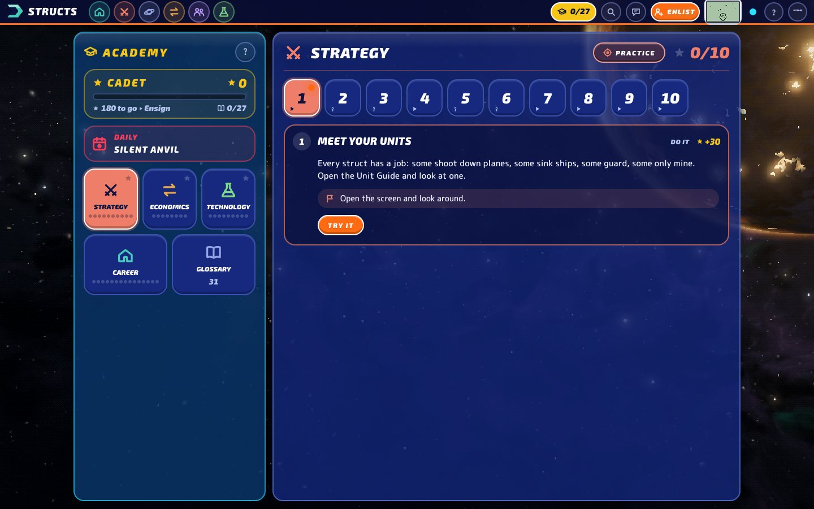 | 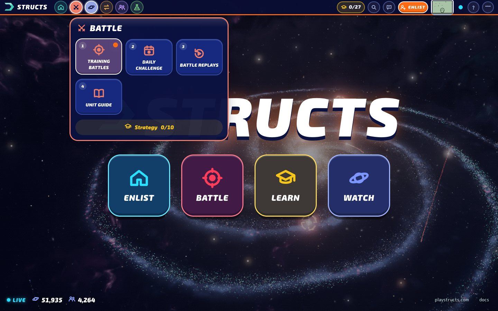 |
| 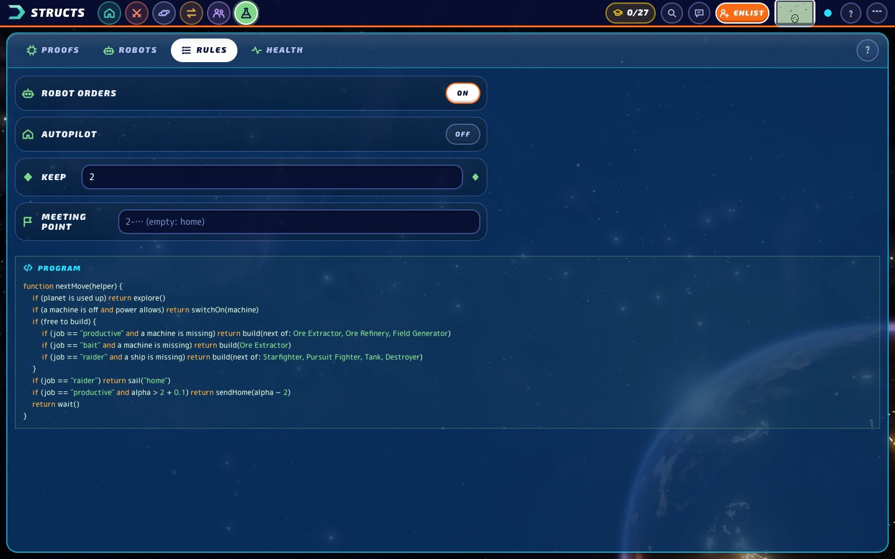 | 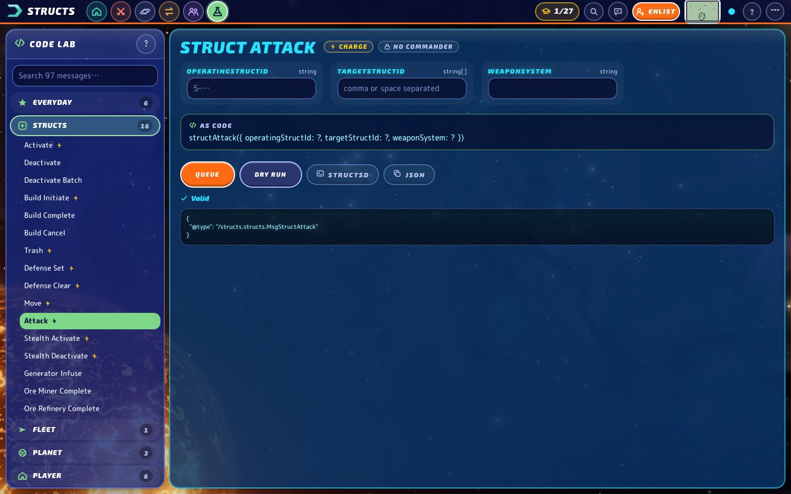 |

### For parents and teachers

The skills it teaches:
- **Strategy:** unit matchups, timing (charge), defence and risk.
- **Economics:** supply and demand, scarcity, prices per unit, exchange rates, and saving versus spending.
- **Technology:** how a blockchain orders moves, proof-of-work puzzles, messages as function calls, and if-then rules for robot helpers.

Safety:
- It plays on the practice network, so its tokens are not real money.
- Commanders use game names.
- Chat warns before anything that looks like a recovery phrase goes out.
- AI helpers suggest moves for the player to approve, and moving alpha always asks.
- *Start the Academy over* in Settings resets lessons for the next learner on a shared computer.

The field manual (More › Field manual › About) says the same in the game.

## Play

This section uses each feature's full name. In the game's hubs they appear in plain words:

| Feature here | Name in the game |
|---|---|
| Command Deck | My Base |
| The Forge | Code Lab |
| Ops | the Engine Room tabs (Moves, Proof Engine, Robot Helpers, Robot Rules, Rank & Missions, Health) |
| Intel | News & Rankings |
| Comms | Chat |
| Battle Simulator | Training Battles |
| Combat Theatre | Battle Replays |
| Codex | Unit Guide |
| The Grid | Power Grid |

- **Vault** (<kbd>V</kbd>): enlisting is a name and a guild. Enlist makes a fresh 24-word phrase and seals it with a device key, a non-extractable AES-256-GCM key in IndexedDB, so there's no passphrase and no word check. You're in the game at once while the guild's signer creates your player in the background; the signup resumes after a reload, then a planet is claimed. The vault shows the phrase any time (copy, or download as .txt) and can move it to a passphrase seal (PBKDF2-SHA256 600k → AES-256-GCM) that locks itself after a quiet spell. You can also import a phrase from the webapp or desktop. Accounts are HD keys on `m/44'/118'/0'/0/i`: index 0 is the commander, the rest are replicants. Send alpha, switch who you act as.
- **Command Deck** (`/command`): your commander's vitals (charge battery, alpha, ore at risk, power, shield, rank), the planet and fleet slot boards with every struct, and what each can do right now. Click a struct to power it, stealth it, guard, move, burn alpha in a generator, scrap it, or fire (arm a weapon, click the enemy structs your fleet can reach). Click an empty slot to build (only the types that fit). Fleet orders: sail by planet id or commander name, return home, the **Target board** (the galaxy's fattest, softest holds, scored live). An **Advisor** lists your next moves, most urgent first, each with its one-click fix. `/command/<playerId>` watches anyone's deck, read-only.
- **Proof of work**: the engine finds every proof your empire owes (builds, mining, refining, raids), grinds them on Web Workers (a midstate SHA-256, ~3 MH/s a thread) and on the GPU through WebGPU (~3 GH/s on an Apple GPU, every proof re-checked on the CPU), keeps the best proof found so far, and submits it the block the chain's falling bar meets it.
- **Transaction queue** (<kbd>Q</kbd> for the dock, `/ops/queue` for all of it): every write goes through one queue. Up to four txs per account per block (a node takes five free txs per address), struct actions wait for their player's charge and for the previous action to land, sequences are tracked locally and re-read on mismatch, hashes are computed before broadcast so a reload or a timeout never double-sends, and landed moves are narrated from their chain events (kills, damage, ore mined, alpha refined, raids won).
- **Replicants** (`/ops/replicants`): more players from your own phrase, born into your guild, each with a role (productive, bait, raider) and standing orders: explore, power up, build the loadout, sweep alpha home, rally. Armada mass actions; doctrine and commander autopilot under **Orders**.
- **The Forge** (`/forge`): every one of the 97 messages the deployed chain accepts, as a form generated from structsd's own proto, with its doc comments, smart pickers (your structs, players, addresses), a dry run against the chain, copy as `structsd` CLI, and one button to queue it.
- **Economy** (`/economy`): **Power** (supply against draw, headroom, a brownout what-if that walks the chain's own cascade order, substations, connections and every allocation verb), **Fuel** (all reactors with validator status, your infusions, infuse / defuse / migrate with capacity previews, defusions with countdowns and cancel), **Market** (energy offers by alpha per kW·day, rent with a quote and balance check, your agreements and providers, become a provider), **Banks** (every guild token's ratio, collateral and supply; convert, redeem and swap with slippage guards), **Transfers** (any account to any address, exact units).
- **Comms** (<kbd>C</kbd> for the dock, `/comms` full screen): Matrix chat on your guild's homeserver, signed in with an access token from another Matrix app (Element, or the guild's own site); signing in with the wallet isn't offered, since each guild's chat login runs only on its own website. Pinned, direct, guild and galaxy channels; unread and mention badges; replies, edits, reactions (game glyphs), pins, search, the room directory, DMs to any commander, members with presence, slash commands, `@` completion. Chain ids in messages become links. Every planet and fleet has a channel (`Planet channel` on the deck and the planet map). Battles can be posted as challenges.
- **Intel** (`/intel`): the guild data layer. **Activity** is the GRASS event stream live (public, no wallet), with the previous visit's feed kept in IndexedDB; **Guilds** (dossiers: profile, power, bank, roster), **Raids**, **Leaderboards**, **Stats** (charts), **Ledger** — public views from the chain and GRASS, members' views from the Guild API once you sign in.
- **Guild Hall** (`/guild`): rosters and ranks, the membership desk (requests, invites, approve, deny, kick, rank), joining another guild, and **Permissions** down to the bit (who may play, hash, transfer for you).
- **⌘K command line**: screens, ids, names, and verbs — `build extractor`, `sail 2-7`, `home`, `explore`, `send 5 to Janet`, `replicate raider`, `rally 2-9`, `targets`, `visit janet` (or `deck janet`), `forge attack`, `academy`, `expert`, `lock`, or a game word like `charge` to see what it means.
- **Health** (`/ops/health`): every link measured — chain socket, LCD latency, GRASS, how many guilds let this site in, comms, vault, the queue's success rate and top errors, the proof engine.
- **Alerts** for every player you command: fire on your structs, raids, ore stolen, hostile fleets in orbit, a grid tipping offline — in-app, and as desktop notifications when the tab is hidden.

| | |
|---|---|
| 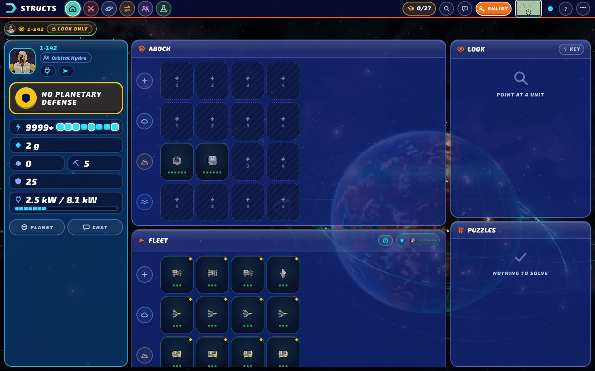 | 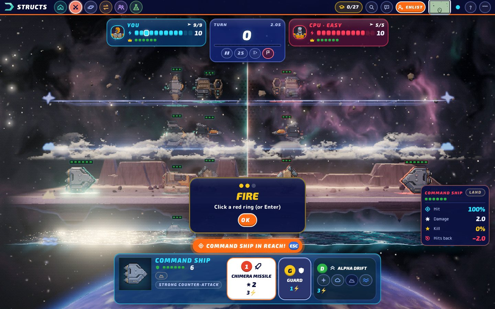 |
| 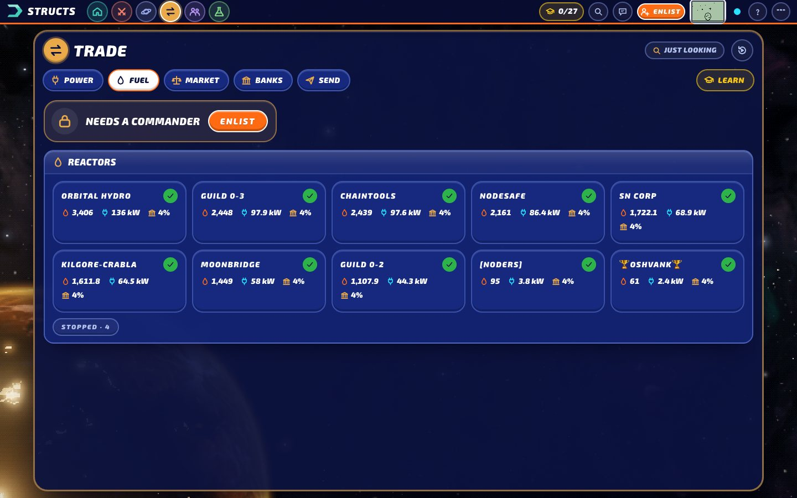 | 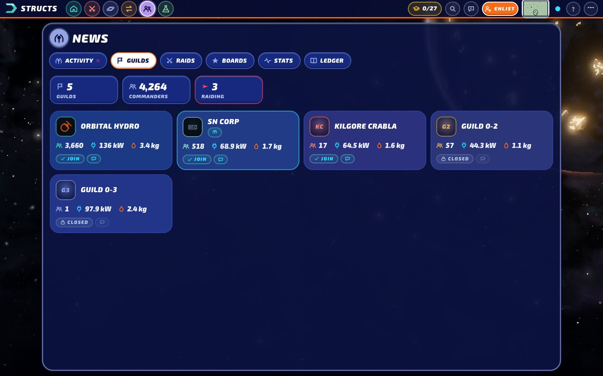 |
|  | 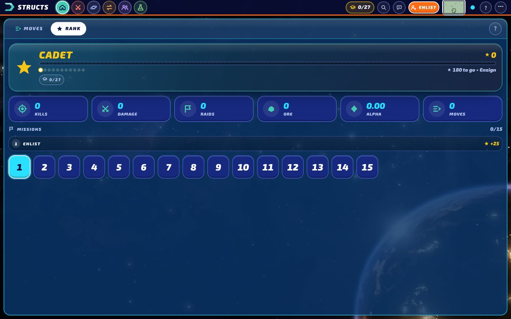 |

## Watch

It also does five things for anyone, keys or not:

- **Live Galaxy**: every planet ever discovered on the Structs testnet, streamed from the chain and drawn as a spiral galaxy. Commanders' home worlds are lit in their guild's colour, and fleets away on raids fly red arcs. Chain events (attacks, raids, builds, mining, refining, new worlds) flare on the map as blocks land. Red reticles mark **battle sites**, the worlds the newest 100 attacks were fought over; click one to watch the latest engagement there. The feed backfills the last few hundred blocks, then follows live. **▶ History** replays the galaxy's discovery world by world, from the core to today's frontier.
- **Planet map**: open any world, by player id, planet id, address or commander name. You get the game's own map layout in 3D: defender Command Ship, planetary slots, home fleet, divider, raider. Beside it is the owner's dossier: charge, power and online status, ore at risk, Alpha Matter, shield, defenses, and the mining and raid clocks, plus the owner's last real fight (one click replays it) and their combat record. A quiet activity log starts with the owner's latest fights from the archive, each a link into the theatre. When a real `EventAttack` touches the planet, its shot rows play back as missiles, blocks, evasions and counter-fire. **Fly the defence / Fly the raid** loads the real fleets into the simulator (hull types, battlegrounds, slots, guard assignments and hull damage). **Pin** a commander to keep their battery, grid status and ore-at-risk in the top bar.
- **Combat Theatre**: every attack ever fought on the testnet (3,000+ and counting), newest first. The LCD's tx search finds each `MsgStructAttack`, and its `EventAttack` carries the whole exchange: attacker, every shot row, blocks, evasions, defender counters, and health before and after. Each replay starts from the **whole battlefield** as it stood the block before the first shot: the planet's own defences, its owner's fleet if it was home, and the raiding fleet with every hull, its Command Ship, standing guard assignments, stealth and damage. The client reads all of this from the chain at that height. The volleys then play over it shot by shot, with narration beside it. Fights older than the node's retained state (before about block 795,000) fall back to the structs the attack names, and the board caption says so. Stepping to another attack on the same planet keeps the board on screen. Only what changed moves: structs that are gone leave, survivors update their health and stealth and slide to new slots, and newcomers appear. Replay restores the field in place. **Whole engagement** gathers the neighbouring attacks between the same two commanders onto one board, plays them in order and ends with a summary (attacks, damage and losses per commander), and **Refight** loads those fleets, as they stood before the first shot, into the simulator (you fly the teal side) to see whether you would have done better. **Autoplay** walks back through the archive, and new attacks join the top as their blocks land. Any attack in the live feed has a **▶ watch** button, and `/combat/<txhash>` links to one directly (`/combat/<txhash>/e` opens its whole engagement). A commander's **combat record** (`/combat/by/<playerId>`, linked from their planet dossier and from the archive's *Most active* line) narrows the archive to the attacks they signed.
- **The Grid**: the energy economy, live: 14 reactors, the substations, every allocation and infusion, and the players connected to each substation. Substations are machined platforms ringing a central hub, with their connected players as discs of light. Reactors hang above as miniature stars in guild colours. Allocations are glass conduits with energy running along them (amber for allocations, cyan for provider agreements), and infusions are violet streams of fuel. Hover a beam (or tap it on a phone) to read its source, destination and power. Click a substation for capacity, load, connections, per-connection share and what feeds it, or a reactor for fuel, commission and its infusers. The energy market (providers and their rates) and each guild's reactors and staked fuel are listed beside it. It stays live: every `EventGrid` record for a reactor, substation or allocation updates the numbers and flares that node or beam.
- **Battle Simulator**: a playable fleet-vs-computer battle. Play presets, random fleets, your own edited layout, or real fleets loaded from the chain. **Gauntlet** runs five escalating engagements: hulls you lose stay lost, damage carries over, and each win earns a reinforcement. The **Daily engagement** (`/sim/daily`) is one scenario per UTC day with a codename and a twist (outnumbered, battered, no escorts, high orbit, fortress). Every commander gets the same fleets, the same dice and the same 2 s pace, so the same orders produce the same battle, and a result can be shared with its replay. **Spectate** lets the computer fly both sides. Every battle can be watched again or shared as an exact **replay** link. The computer's queued orders show up as lock-on lines, since a real mempool is public. Combat is a TypeScript port of structsd's combat rules, executed block by block. It uses the same charge rate limit, evasion rolls, guard blocks, counter-attacks, stealth, Alpha Drift and multi-shot volleys as the chain.

| | |
|---|---|
| 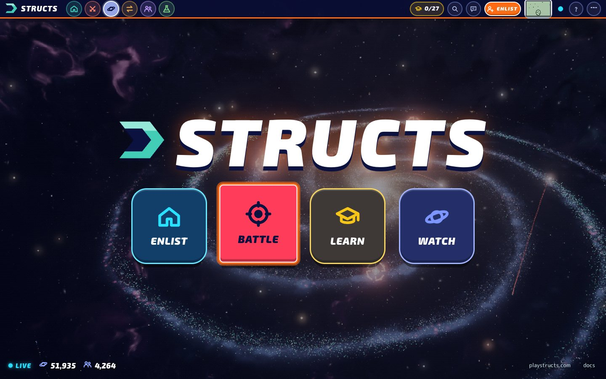 | 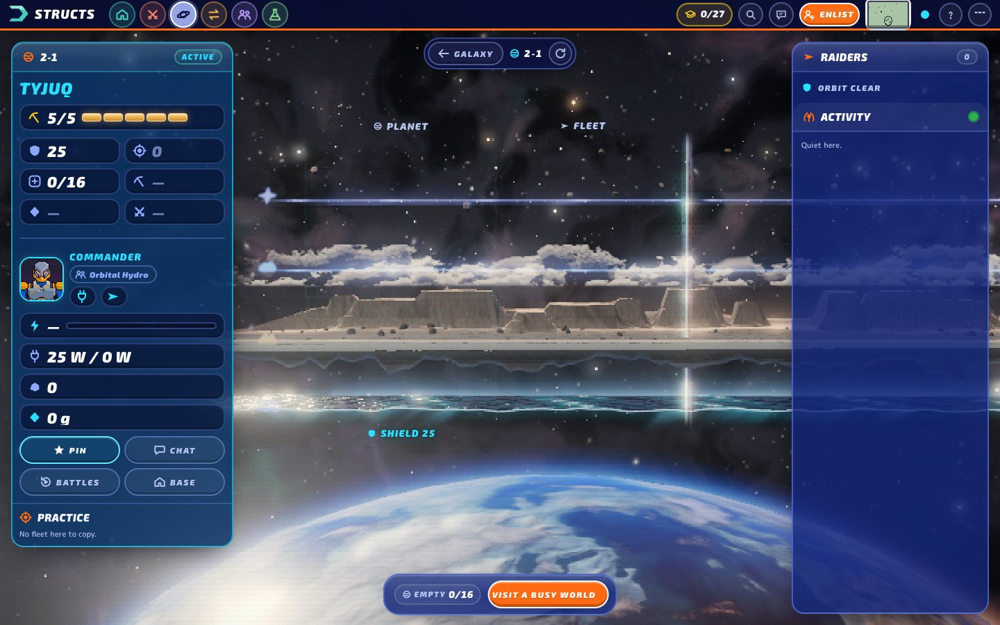 |
| 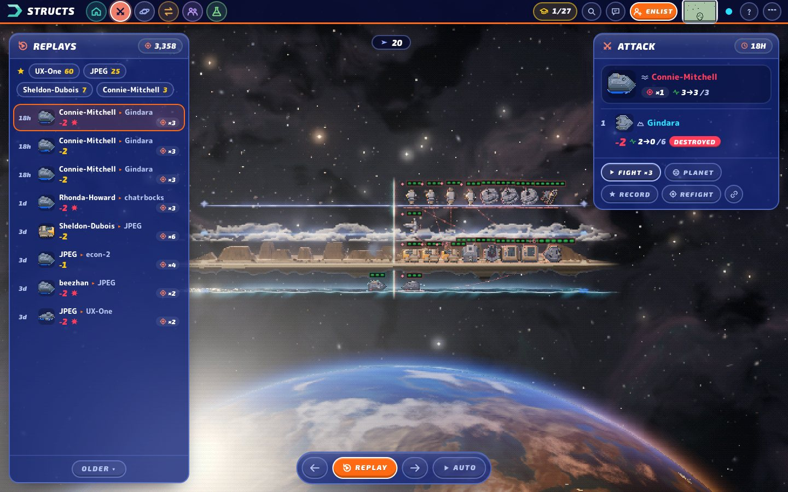 | 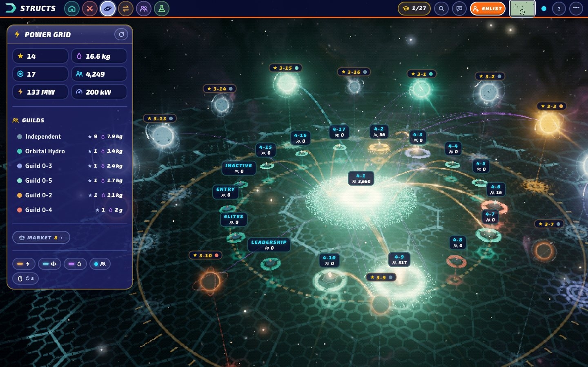 |
| 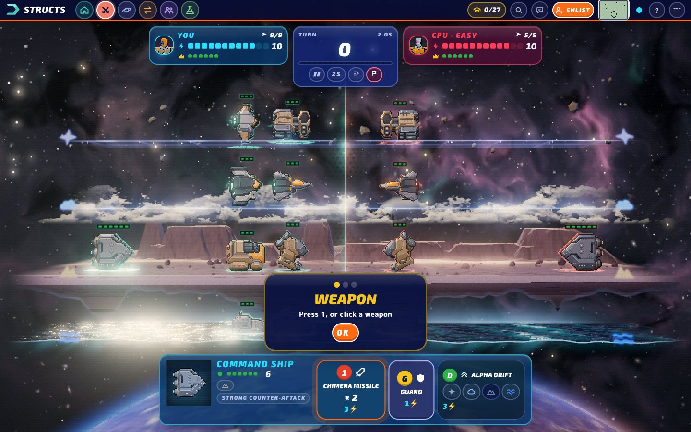 | 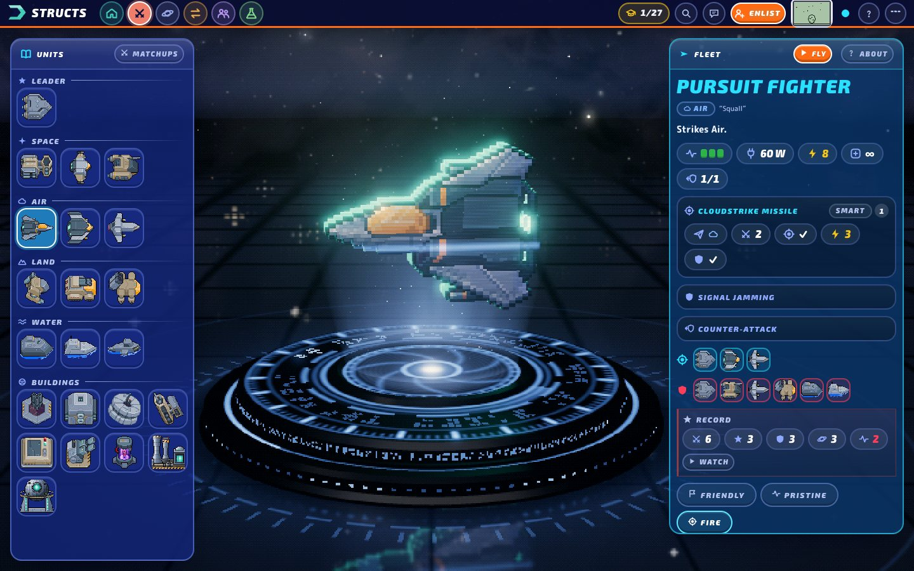 |

A **Codex** covers all 22 struct types. Each one is shown as a 3D model on a holo pedestal with its full mechanics, plus computed matchups: what it can strike and what threatens it, and its **field record** from the newest 100 real attacks (attacks made, kills, shots taken, losses), with a link to watch it fight. A **matchup matrix** gives expected damage per attack for every fleet-vs-fleet pairing, after accuracy, evasion and armour.

First battles get a short field-manual coach (weapons, charge, guards), and **?** explains whichever screen you're on (the full manual is in **More**).

Around all of it: a generative ambient score that intensifies in battle, a settings panel (volume, music, bloom, resolution, reduce motion), raid alerts for a pinned commander, a local service record (battles, wins, kills, flagships, daily streak), phone layouts with pinch-zoom, and screens that load as separate chunks.

## What's live, what's simulated

| Live chain data | Local simulation |
|---|---|
| The galaxy's worlds, commanders, guilds, raids in progress and activity feed | Every battle in the Battle Simulator, Gauntlet and Spectate |
| Planet maps: structs, health, status, guards, raiders, ore, shield, proof-of-work clocks | Fights loaded from a real planet ("Fly the defence/raid"): the fleets are real, the fight is local |
| Real `EventAttack` replays on planet maps and in the Combat Theatre; pinned-commander vitals and raid alerts | Forecasts in the targeting tooltip (forks of the local chain) |
| The energy grid: reactors, substations, allocations, providers, infusions, connections | |

Galaxy coordinates are not on chain. They come from discovery order (see below). Writes are signed in the browser with your vault's keys (see *Signing*).

## Run it

```bash
pnpm install
pnpm dev        # http://localhost:5173
pnpm build      # static site in dist/: any static host, at a domain's root or under a path (see GitHub Pages)
pnpm test       # combat rules, battle codes, PoW decay, AI battles, full sessions, replays, dailies, feed narration, combat-archive parsing
pnpm test:parity  # lockstep parity with structs-universe's simulator-chain.js / simulator-ai.js (needs ../structs-universe)
pnpm smoke        # every screen in headless Chrome: desktop, phone, testnet down, testnet back (needs Chrome, Node 22+)
```

Node 20+ and pnpm 9+. Watching needs nothing. Playing needs a vault (made in the client).

**The page talks to every service itself**: the chain, GRASS, Matrix, and each guild. There is no server-side helper, so any static host works.

Guilds are reached straight from the browser: the page reads each guild's `guild.json` and calls its Guild API, without cookies. That works for any guild that answers with CORS; the live guilds send `Access-Control-Allow-Origin: *`, so their public routes (the clock, guild info, player lookups, and signup, which is how enlisting works) answer any site. Members-only routes (rosters, ledgers, boards) don't: the guild's sign-in opens a session cookie, and a site allowed with `*` can't use one. Those views say so plainly and sign nothing. They would need the guild to allow the site with credentials and a `SameSite=None; Secure` cookie, or to issue a token. The page is strict about what a guild.json may name: https to named public hosts only (no IP literals, local or wildcard-DNS names), the same guild id as the chain, guild.json capped at 64 KB, and no redirects, since a page can't check where they lead. For a guild that doesn't allow your site, the guild-only views say so plainly, enlisting only offers guilds whose API answers, and Ops › Health counts how many guilds let the site in. A refused guild.json is asked again after an hour; being offline doesn't count as a refusal. Chat signs in with an access token from another Matrix app: wallet sign-in walks the guild's login pages, which only run on the guild's own website.

### In a container

```bash
docker build -t structs-xyz .
docker run --rm -p 8080:8080 structs-xyz     # http://localhost:8080
```

`server/serve.mjs` serves the built client (static files only, no dependencies): hashed assets cached for a year, the shell and service worker always revalidated, brotli/gzip, no framing. `pnpm start` runs the same server outside Docker. It runs as the unprivileged `node` user, stops cleanly on `docker stop`, and has a health check on `/healthz`.

- Client endpoints are baked in at build time: `--build-arg VITE_LCD_URL=…` (likewise `VITE_RPC_URL`, `VITE_RPC_WS_URL`, `VITE_GRASS_URL`, `VITE_DEFAULT_GUILD`). Unset means the public testnet.
- `-e PORT=…` changes the port. It keeps no state, so run as many replicas as you like.
- Serve it over HTTPS in production (a reverse proxy or your platform's TLS): the vault's WebCrypto, the service worker and WebGPU need a secure context.

`pnpm smoke` builds the site into a private directory and serves it. It opens all fifteen routes (the Academy among them) in headless Chrome (SwiftShader) at 1440×900 and at a 390×844 phone size. It opens them again with the testnet unresolvable (both the LCD and the WebSocket fail), and once more with the testnet coming back mid-visit, where the galaxy has to recover by itself. A check fails on:

- an uncaught exception, a `console.error`, or a resource error from the site itself;
- a screen that doesn't mount;
- a visible element cut off at the right edge;
- a blank 3D view;
- a live screen that shows no chain data online, doesn't explain an outage offline, or doesn't recover.

Its browsers block each guild's own `guild.json` (looked up once per run), so 46 fresh browsers don't hammer third-party hosts, and a guild refusing the site's origin doesn't count as the site's error. Every DevTools command has a deadline, a renderer crash fails its check, and each check waits for Chrome to exit. The 46 checks take several minutes; `SMOKE_SHOTS=dir` keeps a screenshot of each, and `SMOKE_QUICK=1` runs only the desktop online check of each route. With `VITE_SITE_URL=https://example.github.io/structs-xyz` it builds and serves the site under `/structs-xyz/`, where any file the page asks for outside that path 404s and fails the check. Online checks need the public testnet to be up. Under `CI`, a missing Chrome counts as a failure.

### On GitHub Pages

`.github/workflows/pages.yml` builds and publishes the site on every push to `main` (or from the Actions tab). One-time setup: **Settings → Pages → Build and deployment → Source: GitHub Actions**. For a custom domain, set it there too; no CNAME file is needed.

The workflow asks Pages for the site's address: the custom domain, or `https://<owner>.github.io/<repo>`. The build takes it as `VITE_SITE_URL`. Canonical links, Open Graph tags and the sitemap use the whole address, and its path becomes the base the site lives under, `/` or `/<repo>/` (`vite.config.ts`; `VITE_BASE` overrides it). In the code, routes stay `/codex/5`. `src/core/base.ts` puts the base on the URL bar, on root-relative links and images (in `h()`), and on sounds, art and the service worker. `scripts/prerender.ts` does the same for the pre-rendered pages and refuses a build made for a different base.

Pages has no rewrites, so the build also writes `404.html`: the app shell, marked `noindex`. A route with no page of its own, such as `/planet/2-7`, opens through it and the app routes itself, though the response status is 404. Screens and Codex entries have real pages (`codex.html` and `codex/index.html` both, since `/codex` is also a folder). Pages can't send headers, so the anti-framing rule that `server/serve.mjs` and Vite send as `frame-ancestors` is also enforced by the page itself: framed by another site, it hides and tries to take the whole window. Repository variables (Settings → Secrets and variables → Actions → Variables) override the address and endpoints: `VITE_SITE_URL`, `VITE_LCD_URL`, `VITE_RPC_URL`, `VITE_RPC_WS_URL`, `VITE_GRASS_URL`, `VITE_DEFAULT_GUILD`.

`.github/workflows/ci.yml` runs on every pull request and push to `main`:
- typecheck, tests, and the build both at the root and under a project-page path;
- `pnpm smoke`, then a quick smoke under the project-page path. Smoke needs the live testnet, so it can fail when the testnet is down. It doesn't gate the Pages deploy, which runs its own typecheck and tests.

### A private devnet

`scripts/devnet/` runs the whole game locally — a single-node chain built from the deployed structsd tag, a mock guild API that signs players in the way a real guild does, and the client pointed at both — so every write (signup, builds, proofs, raids, replicants, guild membership, field keys) can be played for real without touching a public service. See `scripts/devnet/README.md`; `pnpm devnet all` then `pnpm devnet:vite`, and open http://127.0.0.1:5186 (127.0.0.1, not localhost: the mock guild's sign-in cookie is same-site only there).

| Variable | Default |
|---|---|
| `VITE_LCD_URL` | `https://public.testnet.structs.network` |
| `VITE_RPC_WS_URL` | `wss://public.testnet.structs.network:26657/websocket` |
| `VITE_GRASS_URL` | the guild's GRASS stream (`off` disables it) |
| `VITE_DEFAULT_GUILD` | `0-5` |
| `VITE_SITE_URL` | `https://structs.xyz` (its path, if any, is the base path; on Pages the workflow sets it) |

Point these at a local `structsd` (`http://localhost:1317`, `ws://localhost:26657/websocket`) to watch a devnet.

## Data channels

Structs clients talk over [three channels](https://structs.ai/develop/client/): REST for bulk reads, a live stream for deltas, and RPC for writes. A static browser client reaches all of them directly:

| Channel | Used for | Notes |
|---|---|---|
| **LCD (Cosmos REST)** | Roster (`/structs/player`, `/fleet`, `/guild`, one request each), every planet (paged, ~1.9 MB gzipped for ~50k worlds), single entities with `gridAttributes` / `planetAttributes` / `structAttributes`, recent history via `cosmos/tx/v1beta1/txs?query=tx.height>…`, the combat archive via `query=message.action='/structs.structs.MsgStructAttack'` (paged with `limit`/`page`) and `txs/<hash>`, and the energy grid (`/structs/reactor`, `/substation`, `/allocation`, `/provider`, `/infusion`, then each entity for its `gridAttributes`) | Sends `Access-Control-Allow-Origin: *` |
| **Tendermint RPC (HTTP)** | `abci_query` with `height=` for `structs.structs.Query/Planet`, `/Fleet` and `/Struct` at a past block, to rebuild a battlefield as it stood before a fight. Requests and replies are protobuf, encoded and decoded in the client by field number from structsd's `.proto` files | The LCD can also answer for a past height, but only through an `x-cosmos-block-height` header whose CORS preflight the public node refuses. The RPC takes the height as a plain parameter and sends `Access-Control-Allow-Origin: *`. The node keeps state from about block 795,000 |
| **Tendermint WebSocket** | `tm.event='NewBlock'` is the client's clock; `tm.event='Tx'` carries structsd's typed `structs.structs.Event*` payloads (attacks with full shot rows, raids, builds, hash completions, ore theft, …) | No replay, so the link state is shown in the top bar and the roster is re-read on reconnect |
| **LCD (writes)** | `POST /cosmos/tx/v1beta1/txs` (broadcast, sync), `POST …/simulate` (gas, dry runs), `/cosmos/auth/v1beta1/accounts/<addr>` (account number, sequence), `GET …/txs/<hash>` (confirmation and the tx's events) | CORS-open for JSON POSTs |
| **Guild API** (each guild's, from its `guild.json`) | rosters, ledgers, boards, membership, sign-in (`LOGIN_GUILD…` signed in the page), signup | Called straight from the page, without cookies. The live guilds send `Access-Control-Allow-Origin: *` (checked 2026-10-10): public routes and signup answer; members-only routes need a session cookie that a wildcard-CORS site can't use |
| **GRASS (NATS over WebSocket)** | the guild's event stream: `structs.>` and `consensus` | Any origin; no auth |
| **Matrix** | guild comms (the homeserver from `guild.json`) | CORS-open; signed in with an access token from another Matrix app |

**When the testnet is down**, every live view says so instead of waiting forever. The galaxy's title and side panel report that it's retrying every 15 seconds. A planet shows *No signal* with a Try again button, and the combat archive and the grid say they couldn't be read and offer Retry or Refresh. LCD reads give up after 20–30 s. The battle simulator, the daily operation and the codex need no network and keep working.

Numbers arrive as strings (uint64). They're normalized once at the boundary: energy is in milliwatts via `BigInt`, and only small bounded fields (slots, health, status flags) become JS numbers.

## Security

- The recovery phrase never leaves the tab. At rest it is AES-256-GCM ciphertext: under the device key by default (anyone with this browser profile can open it, so the phrase is the real backup), or under a passphrase (PBKDF2-SHA256, 600k rounds) once you protect it. A passphrase vault holds the phrase in memory only while unlocked, and its auto-lock counts only your own activity, so automation can't keep an unattended vault open.
- Off-chain signatures (guild login, signup, room creation) are the guild stack's own formats, made in the page and sent straight to the guild.
- A guild.json can only point the page at https services on named public hosts, for the guild the chain names; redirects are refused. There is no proxy of any kind.
- Untrusted data (chain, guild.json, GRASS, Matrix) is rendered as text; links are http(s) only.
- Four review rounds by independent agents (signing and queue, UI, data layer, comms) found and fixed ~45 real bugs, including a double-send window on ambiguous broadcasts.

## Signing

Transactions are built by hand: a small protobuf writer (`src/wallet/proto.ts`), every structs Msg encoded from a schema generated out of structsd's own `tx.proto` at the deployed tag (`node scripts/gen-msgs.mjs v0.21.0` → `src/wallet/schema.gen.ts`), `SIGN_MODE_DIRECT` sign docs, secp256k1 from @noble/curves, keys from @scure/bip32/bip39. `pnpm test` proves it byte for byte: for 19 message types, re-encoding a real testnet transaction's JSON reproduces the exact bytes the chain accepted, and the SignDoc built from them verifies against the signer's real signature. Fees are `0ualpha` (the chain requires it); gas is simulated ×1.6 except for proofs, which skip the dry run because simulation runs a block behind the height that judges them. Struct cards on the planet map show live orders for your own structs, and the `structsd` CLI equivalents for everyone else's.

## How the 3D works

- **Pixel extrusion.** The game's 128×128 struct sprites from structs-webapp are composited layer by layer (bottom weapons → hull → top weapons) and extruded into real geometry. The front and back are alpha-tested quads, and every silhouette edge gets a wall that samples its own pixel's colour. That's one draw call per struct. Lights in the art are recoloured per faction (teal = yours, red = theirs) and fed to an emissive map so they bloom. Continental Power Plant and World Engine have no official sprite, so they're drawn procedurally in the same palette.
- **Hull material.** Each extruded hull carries a per-pixel bevel normal map, so every art pixel reads as a chamfered block, with darker inner walls, a rim light from behind in the faction colour, light bounced up from the tier below (blue off the sea, ochre off the land), a sheen from the baked sky, flickering panel lights, a white-hot hit flash, and shader states for stealth (a refracting shimmer) and construction (a hologram scan). Filtering stays nearest: the chunky pixel look is the point.
- **Pixel shatter.** When a struct dies, its own pixels become instanced debris cubes in the sprite's colours. A fifth of them start glowing hot and cool to bare metal, and hard landings throw sparks.
- **Space.** Each screen's nebula is painted once into an HDR-encoded cube map by a heavy shader: domain-warped emission clouds (hydrogen crimson, ionised-oxygen teal), ridged filaments, dark dust lanes, a Milky-Way band of unresolved stars and faint distant galaxies. After that bake, drawing the sky costs one texture tap per pixel. On top sits a magnitude-graded starfield with colour temperatures and diffraction spikes on the brightest stars.
- **Planets.** One renderer (`gfx/planet.ts`) draws every world: the battle limb, the galaxy's selected world, the command globe and the panel backdrops. Terrain is domain-warped continents, ridged ranges, shelves and ice caps; the data layer holds the ocean mask, city lights and cloud cover. Both are baked into cube maps once per world. Each frame the world gets relief lighting, a sun glint on the seas, cloud shadows, city lights on the night side, a separate cloud shell, and a single-scattering atmosphere that burns orange along the terminator. A spent world is basalt split by glowing fissures.
- **The battle diorama** is the map's ambit stack as a vertical slice of a world, above that planet's limb:
  - **Space:** a holographic deck with drifting asteroids.
  - **Air:** layered cloud banks lit from above.
  - **Land:** a strip of land backed by terraced buttes, with rock strata in the cutaway front.
  - **Water:** an ocean with swell, the nebula reflected in it, a sun glint and foam, over a cutaway water column with light shafts and caustics.

  The two fleets are split by a shimmering energy barrier. Choreography is driven by the chain's shot rows: guided weapons fly curving missiles (torpedoes under water), unguided ones fire shells (artillery lobs), and multi-shot weapons fire tracers. Guards lunge into the line of fire to block, jammed missiles spiral off, maneuvering hulls sidestep, and counters fire back before the volley lands, in the chain's resolution order.
- **The galaxy.** Structs has no on-chain coordinates, so the map encodes the one spatial fact it does have: discovery order. Planet `2-1` is at the core, and each exploration pushes the frontier outward along four arms. A planet's position depends only on its index, so nothing moves as the galaxy grows, and today's commanders visibly live on the rim. The disk is a 2048² map baked on the GPU along the same four arms: old-star light with a short bar, young blue arms, pink star-forming knots and dust. It's drawn as stacked glowing sheets around a dust sheet that reddens what lies behind it, with a golden bulge, about 75,000 field stars and globular clusters. Worlds resolve into lit spheres as you dive in, and the selected one materialises as a full planet.
- **Staging a real attack.** The board is read from the chain one block before the first shot. That read covers the planet (its four ambit lists), the owner's fleet if it was at home, the fleet at the head of the raid queue, and every fleet the fight names. Then each struct is read with its attributes (type, battleground, slot, health, status bits for stealth, offline or under construction) and its defenders, which become guard tethers. Only the commanders in the fight are staged, so other fleets queued at the same planet stay off the board. Structs the fight names but the snapshot lacks (built mid-fight) are added from the `EventAttack`. The snapshot's health wins unless the first attack reports less: the deployed chain overstates an overkilled target's health-before, and counter-firers carry none. Each type's max health is read at that height too, because rules change (planetary structs had 3 before v0.18). Refight fields only hulls that were built and online. The theatre packs each side toward the divider and feeds the untouched shot rows to the same choreography the simulator uses. A board is a few dozen reads, eight at a time, cached per block, so replays are instant. Attacks that share a block replay in that block's own transaction order. Tx search can't be trusted for this, since a descending search reverses transactions inside a block, so the client hashes the block's transactions to recover their order.
- **The grid** is a node-link view in 3D over a holographic hex floor. Substations ring a hub (a substation serving over 40% of connections takes the centre), and each one's connected players form a golden-angle disc sized by √count.
  - **Substations** are machined hex platforms with a spinning crystal and status lights.
  - **Reactors** orbit above as miniature stars: a boiling surface, a corona, plasma loops and flares. A reactor with zero capacity is a cinder.
  - **Allocations** are glass conduits whose light packets move at a speed tied to their power. Infusions are spiralling fuel streams.
  - **Labels** are placed greedily (selected, then nearest) so none overlap.
- **Board zoom.** On the battle, planet and combat boards, the wheel or a pinch scales the fitted camera distance and pans by `c' = p − (p − c)·(d'/d)`, so the point under the cursor stays put. Scale and pan are smoothed together, while sway and framing are smoothed separately underneath.
- **Effects.** One sprite atlas is baked in small slices so no frame stalls: smoke and fire puffs with lighting normals, sparks, star-burst flares and anamorphic streaks.
  - **Particles** are camera-facing quads. Sparks stretch along their motion, fire cools along a blackbody ramp and smoke is lit.
  - **Explosions** run in stages: a white flash, a fireball cooling to soot, sparks and embers, a shock ring, then smoke rising from orange to grey.
  - **Missiles** trail exhaust and corkscrewing smoke, and torpedoes leave bubble wakes.
  - **Shields** are hex-cell domes that ripple out from the hit point.
- **Post.** ACES tone mapping, a half-float MSAA target, an anamorphic streak pass through hot highlights, Unreal bloom, and a final grade pass:
  - a light unsharp mask so pixel art and type stay crisp;
  - a filmic split tone (cool shadows, warm highlights), a soft S-curve and a touch of saturation;
  - vignette, light chromatic aberration, scanline shimmer and luma-weighted grain;
  - hit flashes and camera shake.

  A new screen resolves in through a blocky digital dissolve.
- **Software rendering.** When WebGL runs on a software rasteriser (SwiftShader, llvmpipe, as in VMs, remote desktops and GPU-blocklisted machines), the engine draws at 1×, drops MSAA, bloom and lens streaks, and skips the sky and planet bakes for cheap gradient and palette shading. Phones and tablets bake at half size. A flagship kill drops the board to slow motion and punches the camera in. If frames run slow at 2× pixel ratio, the engine drops to 1×.
- **Battle codes and replays.** A layout is serialised into `/sim/<code>`, so a fight (including one loaded from a real raid) can be shared as a link from the debrief. The chain port is deterministic, so a battle's layout, seed and executed transactions reproduce it exactly. **Watch replay** re-runs it at ×1/×2/×4 through the same animation pipeline, and **Copy replay link** shares it as `/sim/R<code>` (about 2 KB for a typical fight). Anyone can watch the same battle, block for block. Shared codes are untrusted input: every unit, struct id, weapon, battleground and hull value is checked before anything is staged, and anything malformed rejects the link.

## The combat port

`src/sim/chain.ts` is a TypeScript port of `structs-universe/frontend/simulator-chain.js`, which transcribes structsd's keeper (`x/structs`): `MsgStructAttack` (evasion → defender counters → block → volley → target counter → recoil), defense set/clear, Command Ship moves, stealth, and activate/deactivate. It also covers per-player charge, the 5-block destroyed-struct sweep, and fleet defeat when a Command Ship falls away from home. A failed message reverts like a Cosmos tx. The computer player (`src/sim/ai.ts`) judges each candidate attack by playing it forward on forks of the chain. The targeting tooltip does the same thing, using 40 forks per target, to forecast hit, damage, kill and counter-fire odds.

Not modelled, because the fight is between two fleets away from home: planetary structs, the planetary defense cannon, and jamming-satellite interception.

`pnpm test:parity` runs the port and the original JavaScript side by side over seeded AI battles with random noise orders (stealth, (de)activation, defense clears, invalid moves). It compares every block's events, every struct, player, fleet and defender record, and every AI decision. The current result is 0 mismatches over ~3,400 blocks.

## Controls

| | |
|---|---|
| Galaxy | drag to orbit, wheel to zoom, click a lit world for its card, click a feed row to fly there, <kbd>H</kbd> replays history, <kbd>Esc</kbd> deselects |
| Battle | click a hull to select it (or <kbd>Tab</kbd>), <kbd>1</kbd>/<kbd>2</kbd> to arm a weapon then click a red-ringed target (on a touch screen the first tap shows the forecast and a second tap fires), <kbd>G</kbd> to guard, <kbd>D</kbd> to drift the Command Ship, <kbd>S</kbd> for stealth, <kbd>Space</kbd> to pause, <kbd>Esc</kbd> to cancel |
| Battle, planet & combat boards | wheel (or pinch) zooms toward the cursor, double-click or <kbd>Z</kbd> frames the whole board again |
| Setup | click your hull or an empty frame to swap or add structs, select a hull then <kbd>G</kbd> and click an ally to assign a guard, <kbd>Enter</kbd> to engage |
| Codex | drag to turn, arrow keys to step through types, hover or tap a Matrix cell for its breakdown |
| Combat | <kbd>↑</kbd>/<kbd>↓</kbd> newer / older attack, <kbd>R</kbd> replay, <kbd>E</kbd> whole engagement, wheel to zoom, hover or tap a struct for its owner, slot and health |
| Grid | drag to orbit, wheel to zoom, hover or tap a beam for its flow, click a substation or reactor, <kbd>Esc</kbd> to deselect |
| Anywhere | **Find** (or <kbd>/</kbd>, <kbd>⌘K</kbd>): `1-1000`, `42`, `2-48686`, `structs1…`, a name, a screen or a verb; <kbd>?</kbd> for help on this screen; <kbd>P</kbd> to capture the 3D view as a PNG; <kbd>M</kbd> to mute |

Orders follow the reference client's charge gating. If your battery can't cover an order yet, it's held and sent on the first block where it can. Only one order goes out per block. A new order replaces the queued one, and **Cancel** withdraws it.

## Layout

```
src/
  main.ts              router (/galaxy, /planet/2-1, /player/1-1, /combat/<tx>, /grid, /sim, /sim/daily, /codex/9, /command, /ops, /forge, /guild, /economy, /intel, /comms, /academy), top bar, boot
  wallet/              keys, vault (sealed phrase), protobuf writer, Msg encoder + generated schema, tx build/sign/broadcast, the queue
  pow/                 SHA-256 midstate hasher, Web Worker, WebGPU engine, the proof engine (discovery, scheduling, submission)
  game/                empire (your players, live), actions (every verb), replicants (foundry + standing orders), advisor, alerts, targets, onboarding, service record, academy (lesson progress)
  ui/                  vault, ops dock, ⌘K palette, target board, channel opener, hubs (top-bar menus), guide (screen cards, glossary words), welcome, manual, icons; comms/ (panel, timeline, composer, channels, dock); intel/; economy/
  chat/                Matrix client (session, sync, rooms, sends), message model and formatting, guild helpers
  grass/               NATS-over-WebSocket client, the GRASS stream, event narration
  guild/               the Guild API client (auto sign-in), guild directory, direct transport
  cache/               IndexedDB cache (TTL, LRU, stale-while-revalidate, roster snapshots)
  core/                engine (renderer, bloom, grade, shake, capture), DOM kit, in-place URL updates (nav), audio (synth + generative score + stingers), settings, utils
  chain/               lcd.ts (REST), live.ts (Tendermint WS), store.ts (roster, planets, event → feed narration), combat.ts (attack archive), history.ts (the chain at a past block, via abci_query), commander.ts (pinned vitals, alerts)
  data/                struct catalogue (synced from the testnet LCD), lore lines, learn.ts (hubs, glossary, screen guides, Academy lessons)
  gfx/                 pixel extrusion and hull material, fallback art, baked space backdrop, planet renderer, lens streaks, particles / debris / projectiles
  sim/                 combat port, AI, fleet presets, gauntlet, daily scenarios, battle and replay codes
  screens/             galaxy, planet, combat, grid, codex, academy, battle/ (env, scenery, view, session, screen, zoom, record)
scripts/sim.test.ts    rule checks, battle codes, chain-fleet conversion, AI battles, replays, daily scenarios
scripts/store.test.ts  live-feed narration of raw chain events
scripts/combat.test.ts parsing a real attack transaction (fixture), same-block ordering, EventGrid records
scripts/history.test.ts decoding real abci_query replies (planet, raiding fleet, guarded Command Ship) captured at block 2,215,158
scripts/parity.test.ts lockstep parity with the original simulator JS
scripts/wallet.test.ts encodings and signatures against real signed testnet txs (fixtures/signed-txs.json)
scripts/pow.test.ts    midstate SHA-256 vs a reference, nonce editing, the difficulty curve
scripts/gpu.test.ts    the WebGPU kernel's CPU mirror, nonce layout, readback decoding
scripts/game.test.ts   event routing for your empire, buildable types
scripts/data.test.ts   NATS framing against real GRASS frames, the cache, Guild API sign-in (mocked guild)
scripts/chat.test.ts   Matrix sync reduction, mentions, replies, edits, id chips
scripts/economy.test.ts unit parsing, brownout order, bank and reactor math against chain figures
scripts/direct.test.ts guild.json and Guild API straight from the page: URL refusals, CORS refusals, sign-in
scripts/learn.test.ts  the learning layer: hub routes, lessons that can finish, quiz answers, glossary and guide references, the chat phrase guard, matchup practice against the reach rules
scripts/gen-msgs.mjs   regenerates the Msg schema from structsd's proto at a git tag
server/serve.mjs       the static server the container runs (pnpm start)
scripts/smoke.mjs      end-to-end smoke test in headless Chrome (desktop, phone, outage, recovery)
.github/workflows/     pages.yml (build + publish to GitHub Pages), ci.yml (checks, smoke)
docs/                  screenshots
```

## Credits

Game design, mechanics, the SUI palette, fonts, struct art, portraits and sound stingers come from the Structs project ([structs-webapp](https://github.com/playstructs/structs-webapp), [structs-ai](https://github.com/playstructs/structs-ai), structs-universe). The combat rules come from structsd.
